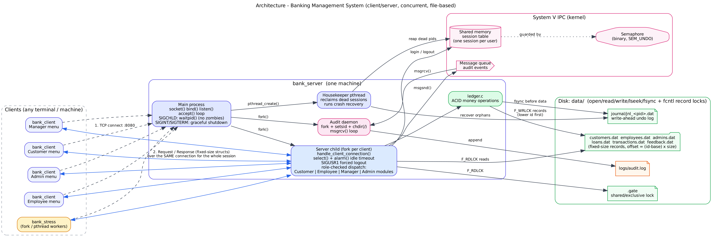
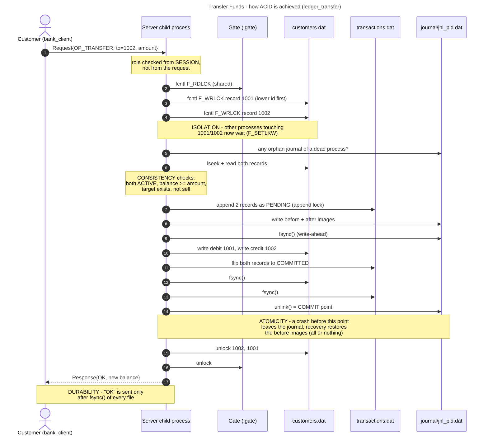

# Design Document — Banking Management System

## 1. Architecture

* **bank_server, main process**: creates the listening socket (`socket`, `setsockopt(SO_REUSEADDR)`, `bind`, `listen`) and loops on `accept()`. For every client it calls `fork()`. This is the concurrent server from slide 114.
* **Server child**: serves one client over one TCP connection for the whole session (`handle_client_connection`). It stores who is logged in (`ClientCtx`), so **the client never sends its own identity**, and every operation is authorised against the role of that session.
* **Housekeeper thread** (`pthread_create`): every 2 s it frees session slots whose owner process has died and rolls back journals left by crashed processes.
* **Audit daemon** (`fork` + `setsid` + `chdir("/")` + `umask` + `dup2` to `/dev/null`): reads events from a message queue with `msgrcv()` and appends them to `logs/audit.log`.
* **bank_client**: a thin terminal UI. It waits on the keyboard *and* the socket with `select()`, so server notices (forced logout, idle timeout, shutdown) appear immediately.

### Signals
| Signal | Where | Purpose |
|---|---|---|
| `SIGCHLD` | main | `waitpid(-1, …, WNOHANG)` loop, so finished children never stay zombies |
| `SIGINT` / `SIGTERM` | main | graceful shutdown: SIGTERM to every child, wait, stop the daemon, `shmctl/semctl/msgctl IPC_RMID` |
| `SIGINT` / `SIGTERM` | child | sends the client "server shutting down", releases the session, exits |
| `SIGALRM` | child | `alarm(idle_timeout)` before waiting for a request; on expiry the session is closed |
| `SIGUSR1` | child | forced logout (sent by the admin, or automatically on deactivation, closure or role change) |
| `SIGPIPE` | all | ignored; writes use `MSG_NOSIGNAL`, so a vanished client returns EPIPE instead of killing the server |

Child handlers are installed **without `SA_RESTART`**, so `select()` returns `EINTR` and the flag is checked. The wait loop also uses a 1-second `select()` timeout, so a signal that arrives between the flag check and the wait is never missed.

## 2. Data storage: binary record files

| File | Record (records.h) | First ID |
|---|---|---|
| `data/customers.dat` | `CustomerRecord` (256 B) | 1001 (also the account number) |
| `data/employees.dat` | `EmployeeRecord` (240 B); employees **and** managers, distinguished by a `role` field | 2001 |
| `data/admins.dat` | `AdminRecord` | 9001 |
| `data/loans.dat` | `LoanRecord` | 5001 |
| `data/transactions.dat` | `TransactionRecord` (append-only ledger) | 1 |
| `data/feedback.dat` | `FeedbackRecord` | 1 |

`offset = (id − first_id) × sizeof(record)`, so every record is reached with one `lseek()` and can be locked on its own. New IDs come from `get_next_id`: the record count (`fstat().st_size / size`), taken under an "append lock". Accounts are never physically deleted. Closing an account sets `status = CLOSED`, which keeps the history.

**Rules that keep this correct** (they cover classic exam questions):
1. **Every process opens its own descriptors after `fork()`** (`db_close_all(); db_open_all();`). A descriptor inherited across `fork()` shares its *file offset* with the parent, so two processes doing `lseek()` + `read()` would move each other's offset.
2. **Each file is opened only once per process.** Closing *any* descriptor of a file drops *all* of the process's `fcntl` locks on that file.
3. Money is stored in integer **paise**. Floating-point money (`double`) would produce rounding errors.

## 3. Concurrency and synchronization

| Mechanism | Used for | Code |
|---|---|---|
| `fcntl(F_SETLKW)` **write lock** on one record | updating an account, loan or feedback item | `db_lock()`, `ledger.c` |
| `fcntl` **read lock** on one record | viewing a balance or details | `db_get()` |
| `fcntl` read/write lock on a whole table | listings and scans, `bank_verify` snapshot | `db_scan()`, `db_scan_update()` |
| **Append lock** (1 byte at offset 2⁴⁰) | two processes appending at the same moment get different slots | `db_append()` |
| **Gate** lock (`data/.gate`) | operations hold it *shared*; crash recovery takes it *exclusive* | `gate_*()` |
| System V **semaphore** (`SEM_UNDO`) | protects the shared-memory session table | `session.c` |

Record locking (advisory, slide 46) lets two customers update **different** accounts in parallel. Only operations on the **same** account wait for each other. `F_SETLKW` makes a process wait for the lock instead of failing, so users never see "system busy, try again" (which is what a non-blocking lock on the whole database would give).

**Deadlock prevention**: there is one global lock order: *gate → employees → loans → customers (ascending id) → transactions → feedback*. A transfer always locks the **lower account number first**, so the opposing transfers A→B and B→A queue on the same lock instead of each holding one lock and waiting for the other (slide 44 lists deadlock as a file-locking problem). The kernel's `EDEADLK` detection is handled as well.

**One session per user**: on login the child takes the semaphore, scans the shared-memory table, refuses if a *live* process (checked with `kill(pid, 0)`) already holds that user, otherwise claims a slot, then releases the semaphore. Because liveness is checked by PID, a client or server process that crashes can never leave a user locked out. (A simple `is_logged_in` flag in the user record would stay set forever after a crash.)

**Proof**: `bank_stress` runs 20 processes making 1000 simultaneous random transfers and confirms the total is unchanged. With `bank_server --no-lock --race-delay 3000` the same run loses ₹50,000+ through lost updates (`scripts/demo_race.sh`).

## 4. ACID

| Property | How it is guaranteed |
|---|---|
| **Atomicity** | Each multi-record operation (deposit/withdraw = account + ledger entry; transfer = 2 accounts + 2 ledger entries; loan approval = loan + account + ledger entry) goes through `journal_commit()`. Before and after images are written to `journal/jnl_<pid>.dat` and `fsync`'d **before** any data file changes. Then the after images are written, the data files are `fsync`'d, and the journal is unlinked (the commit point). Ledger entries are first appended as `PENDING` and only become `COMMITTED` through the journal. If anything dies in between, recovery writes the before images back: **all or nothing**. |
| **Consistency** | Checks run under lock before writing: the account exists and is ACTIVE, the balance never goes negative, amount limits hold, there is no self-transfer, the target account exists (otherwise the debit would have nowhere to go), a loan can only be approved once and only after review, and an account can only be closed with zero balance and no open loans. `bank_verify` checks the invariants: each balance equals the sum of its committed transactions, transfers out equal transfers in, and every approved loan was credited exactly once. |
| **Isolation** | `fcntl` record locks are held from the read until the write (no read-modify-write races). Readers take shared locks, so they never see a half-written record. The gate keeps recovery away from operations that are in progress. |
| **Durability** | `fsync()` of the journal, of the data files, and of the journal directory (so the create/unlink is durable) **before** the client is told "OK". |

**Crash-recovery details.** A crashed process releases its `fcntl` locks automatically (the kernel does it), but it may have written only the debit. Its journal file was created *before* it touched any data and is deleted only *after* the last write. That is why every process checks for orphan journals **after** taking its locks. If it finds one whose owner is dead, it releases everything, runs recovery (gate exclusive), and starts over. The server also recovers at start-up, and the housekeeper thread recovers every 2 s. A journal torn during its own write fails its checksum. It is discarded safely, because no data file had been touched yet.

## 5. IPC and other course topics used

| Course topic (slides) | Where in this project |
|---|---|
| File I/O system calls `open/read/write/lseek/close/fstat/fsync/unlink` (34–43) | `db.c`, `journal.c`, `admin_server.c` (audit log tail via `lseek`) |
| File locking, `struct flock`, `F_SETLKW/F_GETLK`, read vs write locks (44–51) | `locking.c`, `db.c`, `ledger.c` |
| `fork`, process tree, zombies, `wait/waitpid` (68–71) | `server.c`, `bank_stress.c` |
| Daemon process (`setsid`, `chdir`, `umask`) (75–76) | `audit.c` |
| Pipes (79–83) | `bank_stress.c`: "starting gun" + results pipe |
| Message queues `msgget/msgsnd/msgrcv/msgctl` (91–95) | `audit.c` |
| Shared memory `shmget/shmat/shmdt/shmctl` (96–100) | `session.c` |
| Semaphores `semget/semctl/semop`, P/V, `SEM_UNDO` (101–103) | `session.c` |
| Sockets `socket/bind/listen/accept/connect`, `htons`, concurrent server (104–114) | `net.c`, `server.c`, `client.c` |
| `select()` (42) | `ui.c` (client), `server.c` (child wait loop) |
| `alarm()` and timers (115–116) | idle-session timeout in `server.c` |
| Threads `pthread_create/join` (122–124) | server housekeeper thread; `bank_stress --threads` |
| Signals `sigaction`, `kill`, handlers (125–129) | SIGCHLD/SIGINT/SIGTERM/SIGALRM/SIGUSR1 (section 1) |
| `dup2`, `/dev/urandom` via `open/read` | daemon stdio redirection; password salts |

## 6. Requirements traceability

| Spec item | Server function | Client menu |
|---|---|---|
| Customer: login (one session) | `validate_login` + `session_acquire` | Main menu → 1 |
| View balance / deposit / withdraw / transfer | `get_balance`, `deposit_money`, `withdraw_money`, `transfer_funds` → `ledger_*` | Customer 1–4 |
| Apply for a loan | `apply_for_loan` | Customer 5 (6 = view my loans) |
| Change password | `handle_change_password` | Customer 7 |
| Adding feedback | `add_feedback` | Customer 8 |
| View transaction history | `op_passbook` | Customer 9 |
| Logout / Exit | `OP_LOGOUT` / `OP_EXIT` in `dispatch` | Customer 10 / 11 |
| Employee: add new customer | `add_customer` → `ledger_open_account` | Employee 1 |
| Modify customer details | `op_modify_customer` | Employee 2 |
| (closing accounts, from the spec intro) | `delete_customer` | Employee 5 |
| View assigned loan applications | `get_assigned_loans` | Employee 6 |
| Process loan applications | `process_loan` | Employee 7 |
| Approve/Reject loans | `update_loan_status` → `ledger_approve_loan` | Employee 8 |
| View customer transactions (passbook) | `op_passbook` | Employee 9 |
| Manager: activate/deactivate customers | `set_customer_status` | Manager 1 |
| Assign loan applications to employees | `assign_loan_to_employee` | Manager 4 |
| Review customer feedback | `get_all_feedback`, `review_feedback` | Manager 5 |
| Admin: add new bank employee | `add_employee` | Admin 1 |
| Modify customer/employee details | `op_modify_customer`, `update_employee_details` | Admin 2, 3 |
| Manage user roles | `manage_user_roles` (promote/demote), `set_employee_status` | Admin 5 |
| Change password / logout / exit (all roles) | `handle_change_password`, `dispatch` | last 3 items of every menu |

## 7. Design choices (and the simpler alternatives we rejected)

| Simpler alternative | What this project does instead |
|---|---|
| A database library (e.g. SQLite) plus one `flock(LOCK_NB)` on the whole file: concurrent users get "System busy" | Plain record files with system calls only, plus `fcntl` **record** locks that wait (`F_SETLKW`) |
| New TCP connection per request with the client sending its own user ID and role: anyone could impersonate anyone | One connection per session; identity stored in the server process; role checked server-side |
| Debit and credit as separate, un-journaled writes: a bad target account or a crash in between loses money | Target validated under lock; the whole transfer is journaled (all or nothing) |
| An `is_logged_in` flag in the user record: stays set forever after a crash or Ctrl+C | Session slots carry the owner PID, so dead sessions are reclaimed automatically |
| A generic fallback handler that answers SUCCESS for unknown requests | Unknown or unauthorised operations are refused with "Permission denied"; change password is implemented for every role, with the old password verified |
| Text protocol / SQL built with `'%s'`: a `|` or quote in user input breaks it | Fixed-size binary messages; no parsing of user text |
| Plain-text passwords, money as `double` | Salted SHA-256, integer paise |

## 8. Known limitations
* Locks are **advisory**, so only cooperating programs (ours) respect them. That is the normal design for Linux record locking.
* The client and server exchange raw C structs. Both must be built on the same architecture (true for our Linux machines). A production protocol would serialise fields.
* Orphan-journal detection relies on PIDs. If the PID of a crashed process were reused before recovery ran, that journal would wait until the next check or server restart. Start-up recovery always rolls back every journal.
* Shared folders (`/mnt/hgfs`) in VMware do not implement `fcntl` locks reliably. Build and run inside the Linux file system.
